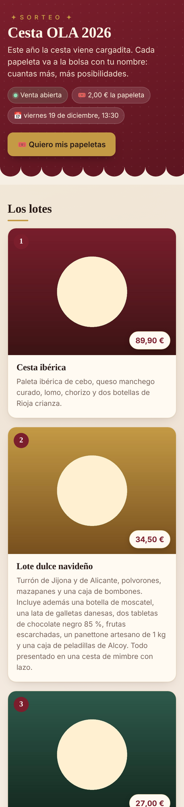
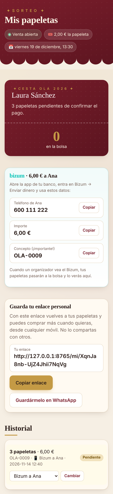
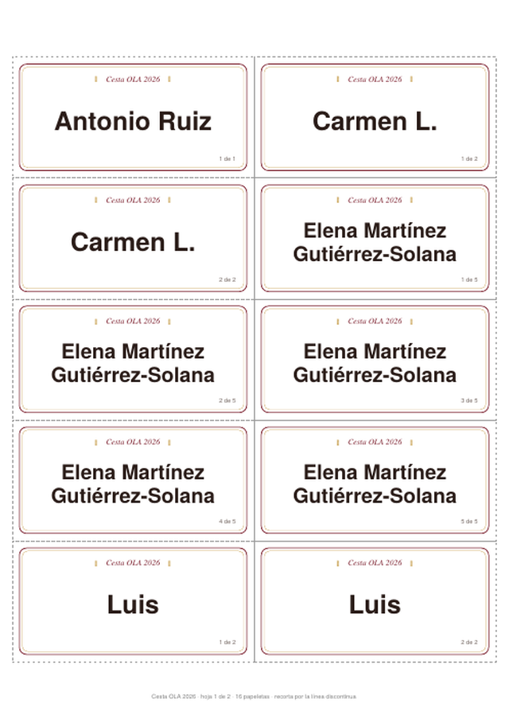
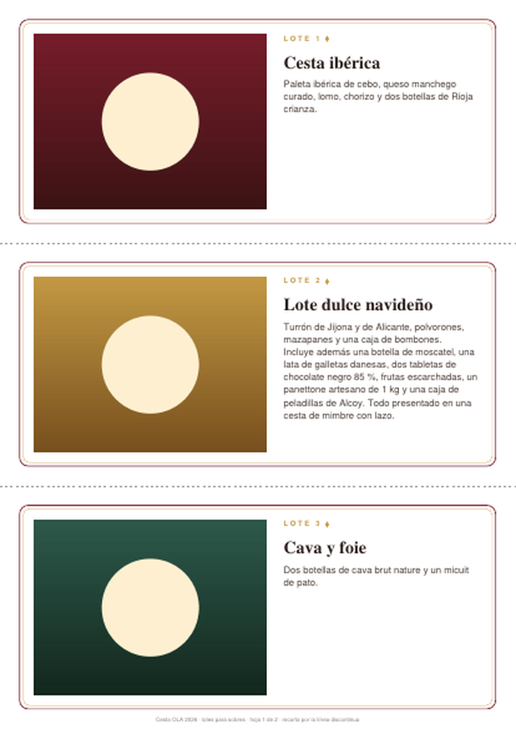

# 🧺 CestaOLA

Web para organizar el sorteo de la cesta de la empresa. Se manda el enlace al grupo de WhatsApp y cada persona:

1. Ve los **lotes** con su foto, descripción y **precio real** (cuentas claras, amigos eternos).
2. Pone su **nombre** y cuántas **papeletas** quiere.
3. Elige **a quién paga**: por **Bizum** a uno de los organizadores (la web le da su teléfono, el importe y un **concepto único** como `OLA-0007` para copiarlos) o **en mano** a uno de los que recogen el dinero.
4. Recibe su **enlace personal** para volver cuando quiera, ver si ya le han confirmado el pago y **comprar más papeletas**. El móvil también la recuerda.

Los organizadores, desde `/admin`:

- **Confirman los pagos** con un toque (*✓ Cobrado*). Hasta entonces las papeletas no entran en la bolsa.
- Ven **quién tiene el dinero**: cuánto ha cobrado y cuánto le falta por cobrar cada organizador, y pueden filtrar los pagos de cada uno.
- Dan de alta a mano a quien paga sin usar la web.
- Gestionan los **lotes** (foto desde el móvil, descripción y precio).
- **Cierran la venta** e imprimen el **PDF de papeletas**: A4 con 10 papeletas de **10 × 5 cm**, una por participación confirmada, con el nombre en grande y línea de corte.
- El día del sorteo apuntan quién ha ganado cada lote (o usan el **sorteo digital ponderado** si no hay bolsa) y lo **publican** en la web.
- Imprimen el **PDF de lotes para sobres**: 3 por A4 vertical, con foto, nombre y descripción, para recortar y meter cada uno en su sobre.
- Descargan un **CSV** con todos los pagos.

<p align="center">
  
  
  
  
</p>

> **Sobre Bizum:** un particular no puede cobrar Bizum *dentro* de una web (para eso hace falta un TPV de empresa con el banco). Por eso la web da los datos para copiar y el organizador confirma cuando ve el Bizum en su banco. El concepto `OLA-0007` sirve para saber de quién es cada uno.

---

## 🖥️ El LXC en Proxmox

| | |
|---|---|
| **Plantilla** | Debian 12 (bookworm) o 13, *standard* |
| **Tipo** | No privilegiado ✔ |
| **CPU** | 1 núcleo |
| **RAM** | 512 MB (swap 512 MB) |
| **Disco** | 4 GB |
| **Red** | IP fija en tu LAN (DHCP con reserva también vale) |
| **Opciones** | Nesting no hace falta. *Start at boot* ✔ |

## 🚀 Instalación (5 minutos)

Dentro del LXC, como root:

```bash
apt update && apt install -y git
git clone https://github.com/hombrelobo2/CestaOLA /opt/cestaola
bash /opt/cestaola/deploy/install.sh
```

Al terminar te muestra la dirección (`http://IP:8000`) y la **contraseña de admin** que ha generado.

Ya puedes probarla desde tu red local. Entra en `/admin` → **Ajustes** y pon título, precio por papeleta, fecha del sorteo, **quién recibe Bizum** (nombre y teléfono, los que queráis) y **quién recoge en mano** (solo nombre). Luego, en **Lotes**, añade los premios.

### Configuración

Está en `/etc/cestaola/cestaola.env`:

| Variable | Para qué |
|---|---|
| `CESTAOLA_ADMIN_PASSWORD` | Contraseña de `/admin`. Compártela solo con los organizadores. |
| `CESTAOLA_BASE_URL` | Dirección pública (`https://cesta.tudominio.es`) para que los enlaces personales salgan bien. |
| `CESTAOLA_COOKIE_SECURE` | `0` para probar por `http://IP:8000`; **`1` cuando esté con HTTPS**. |

Después de cambiarlo: `systemctl restart cestaola`

## 🌍 Publicarla en Internet (HTTPS)

Para que funcione desde los móviles fuera de la oficina necesita HTTPS. Dos opciones:

**A) Cloudflare Tunnel** (no abre puertos en el router). En el LXC:
```bash
curl -L https://pkg.cloudflare.com/cloudflare-main.gpg -o /usr/share/keyrings/cloudflare-main.gpg
echo "deb [signed-by=/usr/share/keyrings/cloudflare-main.gpg] https://pkg.cloudflare.com/cloudflared $(. /etc/os-release; echo $VERSION_CODENAME) main" > /etc/apt/sources.list.d/cloudflared.list
apt update && apt install -y cloudflared
```
En el panel de Cloudflare (*Zero Trust → Networks → Tunnels*) crea un túnel, copia el comando `cloudflared service install <token>` y añade un *Public hostname* `cesta.tudominio.es` → `http://localhost:8000`.

**B) Tu proxy inverso** (Nginx Proxy Manager, Caddy, Traefik…): un host `cesta.tudominio.es` → `http://IP-del-LXC:8000` con certificado Let's Encrypt. La app ya entiende las cabeceras `X-Forwarded-*`. Si subís fotos grandes, sube el límite del proxy (en NPM: *Advanced* → `client_max_body_size 25m;`).

Luego, en `/etc/cestaola/cestaola.env`:
```
CESTAOLA_BASE_URL=https://cesta.tudominio.es
CESTAOLA_COOKIE_SECURE=1
```
y `systemctl restart cestaola`.

## 🖨️ Imprimir las papeletas

1. **Pagos → Cerrar la venta** (para que no entre nadie más).
2. Revisa que no queden pagos pendientes que sí hayas cobrado.
3. **Papeletas para la bolsa (PDF)** → imprime a **tamaño real / 100 %** (sin "ajustar a la página") para que salgan de 10 × 5 cm.
4. Recorta por la línea discontinua. Cada papeleta lleva "3 de 5" para que puedas comprobar que están todas.

Si dos personas se llaman igual, el panel te avisa ⚠ y puedes editar el nombre (por ejemplo, "Luis G." y "Luis M.").

## 🔧 Mantenimiento

```bash
bash /opt/cestaola/deploy/actualizar.sh   # actualizar a la última versión
bash /opt/cestaola/deploy/copia.sh        # copia de seguridad en /root
journalctl -u cestaola -f                 # ver el registro
```

Los datos (base de datos SQLite y fotos) están en `/var/lib/cestaola`. Para empezar de cero el año que viene: haz una copia, `systemctl stop cestaola`, borra `/var/lib/cestaola/cestaola.db*` y arranca de nuevo. También puedes simplemente hacer un *snapshot* del LXC en Proxmox antes.

## 🧪 Desarrollo

```bash
python3 -m venv .venv && .venv/bin/pip install -r requirements.txt pytest
CESTAOLA_ADMIN_PASSWORD=prueba .venv/bin/python wsgi.py   # http://127.0.0.1:8000
.venv/bin/python -m pytest -q
```

Hecho con Flask, SQLite y ReportLab. Sin JavaScript de terceros ni fuentes externas: carga rápido incluso con mala cobertura.
